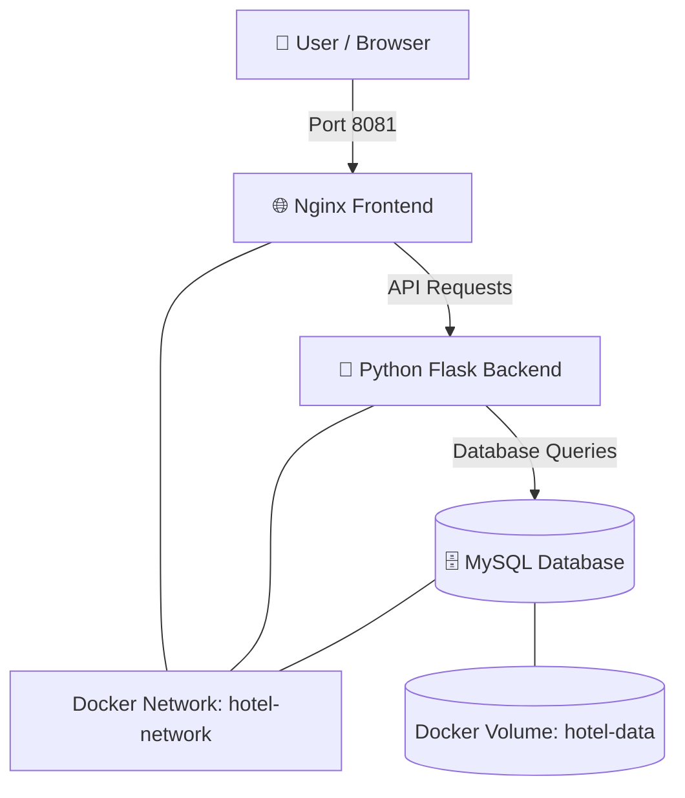

# 🏨 Docker 3-Tier Hotel Booking Application

<p align="center">
  <b>A containerized hotel booking application deployed on AWS EC2 using Docker.</b>
  <br/>
  Built with Nginx, Python Flask, MySQL, and Docker.
</p>

<p align="center">
  
  
  
  
  
</p>

---

## 📌 Project Overview

This project demonstrates the deployment of a **3-tier hotel booking application** using Docker containers on an AWS EC2 instance.

The application separates the frontend, backend, and database into three independent containers. Docker networking enables communication between services, while Docker volumes provide persistent database storage.

## 🏗️ Architecture



### Application Components

| Component | Technology | Purpose |
|---|---|---|
| Frontend | HTML + Nginx | User interface |
| Backend | Python Flask | API and booking logic |
| Database | MySQL 8.0 | Stores rooms and bookings |
| Containerization | Docker | Runs services independently |
| Networking | Docker Network | Container communication |
| Storage | Docker Volume | Persistent database storage |
| Cloud | AWS EC2 | Application hosting |

## ⚙️ Technologies Used

- 🐳 Docker
- ☁️ AWS EC2
- 🌐 Nginx
- 🐍 Python Flask
- 🗄️ MySQL
- 🐧 Linux
- 🔗 Git & GitHub

## 📂 Project Structure

```text
Docker-3-Tier-Hotel-Booking-Project/
│
├── backend/
│   ├── app.py
│   ├── requirements.txt
│   └── Dockerfile
│
├── frontend/
│   ├── index.html
│   ├── Dockerfile
│   └── nginx.conf
│
├── .gitignore
└── README.md
```

## 🚀 Deployment Steps

### 1. Create Docker Network

```bash
docker network create hotel-network
```

### 2. Build Docker Images

```bash
docker build -t hotel-backend:v1 ./backend

docker build -t hotel-frontend:v1 ./frontend
```

### 3. Pull MySQL Image

```bash
docker pull mysql:8.0
```

### 4. Create Docker Volume

```bash
docker volume create hotel-data
```

### 5. Run MySQL Container

```bash
docker run -d \
  --name hotel-db \
  --network hotel-network \
  -e MYSQL_ROOT_PASSWORD="YOUR_ROOT_PASSWORD" \
  -e MYSQL_DATABASE=hoteldb \
  -e MYSQL_USER=hoteluser \
  -e MYSQL_PASSWORD="YOUR_DB_PASSWORD" \
  -v hotel-data:/var/lib/mysql \
  -p 127.0.0.1:3307:3306 \
  mysql:8.0
```

Use credentials matching your backend configuration. Never commit real passwords.

### 6. Run Backend Container

```bash
docker run -d \
  --name hotel-backend \
  --network hotel-network \
  -p 127.0.0.1:5001:5000 \
  hotel-backend:v1
```

### 7. Run Frontend Container

```bash
docker run -d \
  --name hotel-frontend \
  --network hotel-network \
  -p 8081:80 \
  hotel-frontend:v1
```

### 8. Verify Running Containers

```bash
docker ps
```

## 🌍 Access the Application

Open your browser:

```text
http://YOUR-EC2-PUBLIC-IP:8081
```

Ensure TCP port `8081` is allowed in your EC2 security group, preferably only from your IP address.

## 🔍 API Endpoints

| Method | Endpoint | Description |
|---|---|---|
| GET | `/api/rooms` | Retrieve available rooms |
| POST | `/api/bookings` | Create a booking |
| GET | `/api/bookings` | Retrieve bookings |

## 💡 Key Learning Outcomes

- Built custom Docker images using Dockerfiles.
- Deployed a multi-container application.
- Implemented container-to-container communication.
- Configured Docker bridge networking.
- Implemented persistent storage using Docker volumes.
- Configured Nginx as a reverse proxy.
- Deployed a containerized application on AWS EC2.
- Practiced Linux and Git commands.

## 🔮 Future Improvements

- Docker Compose for managing multiple containers.
- CI/CD automation using GitHub Actions.
- HTTPS configuration with SSL certificates.
- Improved secrets management.
- Application monitoring and logging.

## 👨‍💻 Author

**Vaibhav Gadge**

🎓 Final-Year BCA Student | Aspiring Cloud & DevOps Engineer

🔗 **GitHub:** [@vaibhuz](https://github.com/vaibhuz)

---

<p align="center">
  ⭐ If you find this project useful, consider giving it a star!

